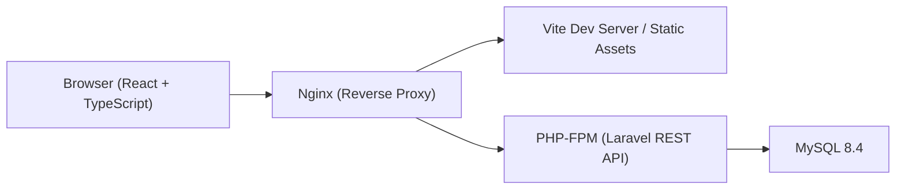
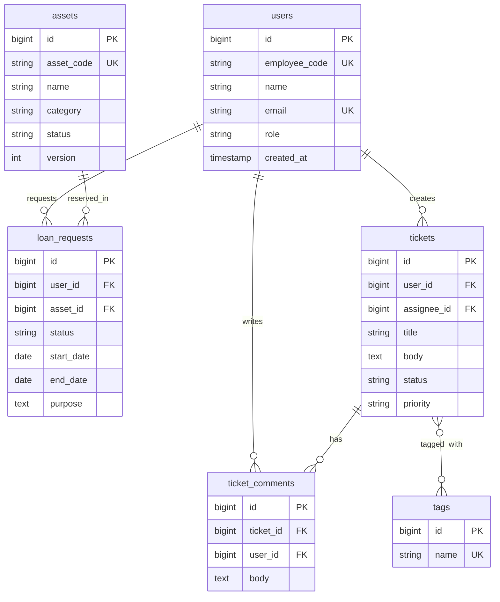

# React + TypeScript + PHP 学習兼ポートフォリオ企画書

- 作成日: 2026-11-24
- リポジトリ: `~/workspace/try-react-php/`
- 対象ポジション: 株式会社ハル研究所 キャリア採用「コーポレートウェブシステムエンジニア」

---

## 1. 本プロジェクトの目的（ゴール定義）

本プロジェクトのゴールは **「立派なシステムを完成させること」ではない**。
以下の2点を達成し、2026年12月の再応募（書類選考・技術面接）を突破することを目的とする。

1. **React + TypeScript と モダンPHP + SQL の実戦スキルを自分の手で身につけること**
   - 既存の強み（Vue.js / TypeScript / Java / Ruby on Rails / 旧PHP / DB設計・DX改善）を
     React とモダンPHPに接続し、差分を言語化できる状態にする。
2. **「どんな課題に対して、どんなシステムを設計し、何を工夫したか」を面接で自分の言葉で語れること**
   - 実装の過程で直面した設計判断・トレードオフ・つまずきと解決策を「設計メモ（ADR / 学びログ）」
     として蓄積し、面接の深掘り質問に即答できるようにする。

---

## 2. 題材（作るシステムの概要）

### 仮称: CorpDesk（社内ITサポート・備品貸出＆ナレッジポータル）

ハル研究所の募集要項にある **「社内Webサービスの企画・立案・設計・開発・保守」**
**「ユーザー（社員）サポート」「利用者100名以上のサービス設計」「データベース設計」**
に直結する題材を選定する。

### 想定する社内課題（企画の背景）

- 社員数100〜300名規模の開発会社（ゲーム開発者・デザイナー・管理部門など多様な職種が在籍）で、
  検証機・開発端末・ソフトウェアライセンスの貸出申請やIT問い合わせがチャットや表計算に分散している。
- 申請状況が見えず、在庫の二重予約や「同じ質問への繰り返し対応」が発生し、社員・情シス双方の時間を奪っている。

### 提供価値（ハル研究所の理念との接続）

- クリエイターや社員がストレスなく必要な機材・情報にアクセスできる「社内道具」を提供することで、
  本来のモノづくりに集中できる環境（社員のHappy）を支える。

### コア機能（学習効果と面接での語りやすさを優先して厳選）

| カテゴリ | 機能 | 学べる技術・面接で語れる設計論点 |
| --- | --- | --- |
| 認証・認可 | ログイン / ログアウト、ロール制御（一般社員 / 管理者） | セッション/Cookie認証（Sanctum等）、CSRF/XSS対策、認可ポリシー |
| 備品・機材貸出 | 機材一覧・検索、貸出申請、管理者承認、返却処理 | **トランザクション・排他制御（二重予約防止）**、状態遷移設計、監査ログ |
| 問い合わせ＆FAQ | チケット起票、コメント、FAQナレッジ検索・サジェスト | キーワード検索・絞り込み・ページング、N+1問題対策、複合インデックス |
| ダッシュボード | 貸出中一覧、未対応チケット件数、期限超過アラート | SQL集計クエリ、Reactの状態管理・キャッシュ設計 |

---

## 3. 技術スタックと選定理由

`nuc7` の環境（Node v26 / pnpm / Docker Compose 導入済み、ホストPHP未導入）に合わせ、
**Docker Compose でワンコマンド起動できる構成** とする。

| レイヤー | 採用技術 | 選定理由・面接でのアピールポイント |
| --- | --- | --- |
| フロントエンド | TypeScript / React 19 / Vite | 募集要項の必須スキル。Vue.js実務経験との対比で学習効率を最大化 |
| UI・フォーム・通信 | React Router / TanStack Query / React Hook Form + Zod | サーバー状態とクライアント状態の分離、型安全なバリデーション |
| バックエンド | PHP 8.4 / Laravel 12（REST API構成） | 国内PHP実務の標準。MVC・Migration・FormRequest・Policy・PHPUnitを習得 |
| データベース | MySQL 8.4 (LTS) | 社内Webサービスで広く使われるRDBMS。正規化・外部キー・インデックス・ロック制御 |
| インフラ・DX | Docker Compose (Nginx + PHP-FPM + MySQL + Vite) / GitHub Actions | 環境差異ゼロの再現性。現職の強みであるDX改善・CI/CD・自動テストを体現 |
| 品質管理 | PHPStan / Pint / PHPUnit / ESLint / Vitest | 静的解析と自動テストにより、保守性の高いコードを書く姿勢を証明 |

### システム構成図



---

## 4. データベース設計（初期ER図案）

「データベース設計の経験」「利用者100名以上のサービス設計」を面接で語れるよう、
実務レベルの正規化・履歴管理・整合性制約を意識する。



### DB設計で意図的に盛り込む工夫（面接の語りどころ）

- **二重貸出の防止**: `assets` の状態更新と `loan_requests` 作成をトランザクションで囲み、
  行ロック（`SELECT ... FOR UPDATE`）または楽観ロック（`version` カラム）で競合を防ぐ。
- **検索パフォーマンス**: チケット一覧の「ステータス × 担当者 × 更新日時」に対する複合インデックス設計と
  `EXPLAIN` による検証。
- **N+1問題の解消**: チケット一覧取得時の Eager Loading（`with()`）と発行SQLの計測比較。
- **安全なスキーマ管理**: Migration + Seeder（ダミー社員150名・機材200件・チケット1,000件）で、
  100名以上利用時の挙動をローカルで検証。

---

## 5. スキルを確実に身につけるための学習ルール（AI活用方針）

「AIが作ったよく分からないコード」にならないよう、以下のルールで進める。

1. **自分で設計・実装する領域（自力実装・写経）**
   - DBマイグレーション・ER設計
   - Laravel の主要な Controller / Service / FormRequest / Policy
   - React の主要コンポーネント・カスタムフック・状態設計・API連携
2. **AIを壁打ち・レビュー役として使う領域**
   - 設計レビュー（「このテーブル設計に落とし穴はあるか？」）
   - Vue.js / Java との比較解説（「Vueの computed に相当する React の設計は？」）
   - コードレビュー・リファクタリング提案・テストケースの洗い出し
   - Docker設定やボイラープレートの雛形確認
3. **毎フェーズ必ず残す「学び・工夫ログ」**
   - `docs/adr/`（設計判断メモ）と `docs/interview-notes.md`（面接用QAメモ）に、
     **「なぜその技術・設計を選んだか」「別の案とどう比較したか」「ハマった点と解決策」**を自分の言葉で記録する。

---

## 6. 開発・学習ロードマップ（12月5日説明会〜12月中旬応募向け）

### Phase 0: 環境構築と土台づくり（1〜2日）

- Docker Compose（Nginx / PHP 8.4 / MySQL 8 / Node）でローカル開発環境を構築
- Laravel API の疎通確認（`/api/health`）と React + TypeScript + Vite の疎通確認
- PHPStan / ESLint / GitHub Actions の最小CIを最初に通す
- **習得ポイント**: PHP-FPM と Nginx の連携、CORS・Cookie設定の基本

### Phase 1: DB設計・シードデータ・認証基盤（2〜3日）

- Migration / Model / Factory / Seeder 作成（150名規模のダミーデータ生成）
- セッションベース認証（ログイン / ログアウト / ログインユーザー取得）とロール認可（一般社員 vs 管理者）
- **習得ポイント**: Laravel の認証・認可（Sanctum / Policy）、パスワードハッシュ・CSRF対策

### Phase 2: 機材一覧＆貸出申請（React基礎 + PHP API基礎）（3〜4日）

- バックエンド: 機材一覧（検索・絞り込み・ページネーション）、貸出申請・承認・返却API
- フロントエンド: 一覧画面、検索フォーム、申請モーダル、状態バッジ
- **習得ポイント（Vue経験者向け重点）**:
  - React のレンダリングサイクル、`useState` / `useEffect` の使い分け（不要な `useEffect` を書かない設計）
  - TanStack Query によるサーバー状態管理（キャッシュ・再取得・ローディング/エラー表示）
  - React Hook Form + Zod による宣言的なフォームバリデーション

### 12月5日(土) 11:00 オンライン会社説明会（軌道修正ポイント）

- 実際の社内システムの技術スタック（React/PHPのバージョン、フレームワーク、DB、認証方式、直近の課題）をヒアリング
- 説明会で得た一次情報を Phase 3 以降の機能・工夫に反映する

### Phase 3: 排他制御・問い合わせ＆FAQ機能（3〜4日）

- 貸出申請の同時実行制御（トランザクション + 行ロックまたは楽観ロック）と単体・結合テスト
- 問い合わせチケット起票・コメント機能・FAQサジェスト
  （「起票前に関連FAQを提示して自己解決を促す」社員サポート目線のUX工夫）
- N+1問題の確認と `EXPLAIN` によるSQLチューニング体験
- **習得ポイント**: トランザクション境界、実務レベルのSQL最適化、テストコード（PHPUnit / Vitest）

### Phase 4: UX磨き込みとドキュメント整備（2日）

- キーボード操作・ローディングスケルトン・分かりやすいエラーメッセージなど、非エンジニア社員でも迷わないUI改善
- `README.md` 整備（背景・構成図・ER図・工夫した点・画面キャプチャ・起動手順）

### Phase 5: 面接トーク集の完成と書類反映（1〜2日）

- ポートフォリオのURL・構成・工夫点をハル研向け職務経歴書に反映
- `docs/interview-notes.md` に想定質問への回答を完成させる

---

## 7. 面接で答えられるようにする想定質問リスト（ゴール指標）

本プロジェクト完了時に、以下の質問に自分の体験ベースでスラスラ答えられる状態をゴールとする。

### React / フロントエンド関連

1. **Vue.js の実務経験がある中で、React を学んで感じた設計思想の違いは何ですか？**
   - 例: リアクティビティ（Proxyによる自動追跡 vs イミュータブルな状態更新と再レンダリング）、テンプレート構文 vs JSX、状態管理の考え方。
2. **React でパフォーマンスや再レンダリングを意識して工夫した点はありますか？**
   - 例: サーバー状態を TanStack Query に分離し、コンポーネントのローカル状態を最小化した点、不要な `useEffect` を避けた点。
3. **フォーム入力やバリデーションはどう設計しましたか？**
   - 例: フロント（Zod + React Hook Form）とバックエンド（Laravel FormRequest）で責務を分けつつ、入力体験と堅牢性を両立した点。

### PHP / バックエンド・DB関連

1. **Java や Rails と比較して、モダン PHP（PHP 8系 + Laravel）を書いてみてどう感じましたか？**
   - 例: 型宣言・Enum・Readonlyクラスによる型安全性の向上、PHPStanによる静的解析、Eloquentとクエリビルダの使い分け。
2. **100名以上の社員が同時に使う前提で、DB設計やAPI設計で工夫した点はありますか？**
   - 例: 備品貸出の二重申請を防ぐロック設計、一覧検索の複合インデックスと `EXPLAIN` 検証、N+1問題の解消、150名相当のシードデータでの負荷・ページング確認。
3. **セキュリティ面で意識した対策は何ですか？**
   - 例: プリペアドステートメント（SQLインジェクション対策）、CSRF/XSS対策、管理者機能に対するサーバーサイド認可（Policy）の徹底。

### コーポレートエンジニアとしての姿勢・企画力

1. **なぜこのアプリを題材に選び、どんなユーザー目線の工夫を入れましたか？**
   - 例: 問い合わせ起票時に関連FAQをサジェストして社員の待ち時間を減らす工夫、申請状況を一目で把握できるUI、非エンジニアでも迷わないエラーメッセージ設計。
2. **開発中に一番ハマったトラブルと、それをどう解決しましたか？**
   - Phase 0〜3 の実体験をそのまま `docs/interview-notes.md` に記録し、STAR法で語れるようにする。

---

## 8. 推奨ディレクトリ構成（作成予定）

```text
try-react-php/
├── PROPOSAL.md              # 本企画書
├── README.md                # 採用担当者・面接官向けのポートフォリオ概要
├── compose.yaml             # Nginx / PHP-FPM / MySQL / Vite
├── docs/
│   ├── adr/                 # 設計判断メモ（なぜこの技術・設計にしたか）
│   └── interview-notes.md   # ハマった点・工夫点・面接想定QAメモ
├── backend/                 # Laravel 12 (PHP 8.4) REST API
├── frontend/                # React 19 + TypeScript + Vite
└── docker/                  # Nginx / PHP Dockerfile・設定ファイル
```
