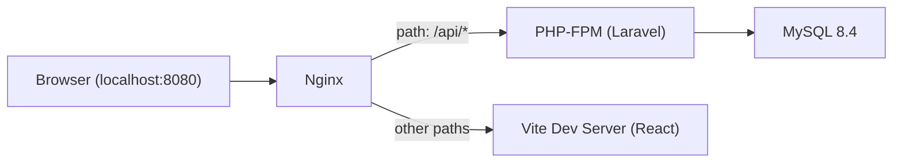

# Step 0: 環境構築と土台づくり（Docker Compose + Laravel + React/Vite）

- 目安: 1〜2日
- ゴール: `docker compose up -d` で Nginx / PHP-FPM (Laravel) / MySQL / React (Vite) が起動し、ブラウザから Laravel の `/api/health` を React 経由で呼び出せる状態にする。

---

## 1. このステップで理解すること

### 1-1. リクエストの流れ（なぜ Nginx を挟むのか）

Java（Spring Boot / Play）や Rails ではアプリサーバー自体が HTTP を受けることが多いですが、PHP は通常 **Nginx（Webサーバー） + PHP-FPM（FastCGI プロセスマネージャ）** の2段構成で動かします。



**この構成にするメリット（面接でもそのまま語れる）**:

- ブラウザから見てフロント（`/`）も API（`/api/*`）も **同一オリジン（`http://localhost:8080`）** になる。
- そのため、複雑な CORS 設定やクロスサイト Cookie の罠を避けつつ、本番環境に近い構成でセッション認証（Sanctum）を安全に扱える。

### 1-2. モダン PHP（PHP 8.x）の最低限の知識

昔の PHP 5 時代と大きく変わっている点（面接で「モダンPHPを理解している」と伝えるポイント）:

- **厳格な型宣言**: `declare(strict_types=1);`、引数の型・戻り値の型・Union型・`readonly` プロパティ・`enum` が標準。
- **Composer**: Node の `pnpm` / Java の `Gradle` に相当するパッケージマネージャ（`composer.json` / `composer.lock`）。
- **PHPStan**: TypeScript の型チェックのように、実行前に静的解析でバグを検出するツール。

### 1-3. Laravel で定番の PHP 拡張モジュール

`Dockerfile` で導入する PHP 拡張モジュールの役割と用途です。

| 拡張 | 役割 | 他言語との対応イメージ | Laravel / 本プロジェクトでの用途 |
| --- | --- | --- | --- |
| `pdo_mysql` | PDO の MySQL ドライバ | Java の **JDBC ドライバ** | Eloquent / クエリビルダ / マイグレーションで MySQL に接続するために必須。プリペアドステートメント（SQLi 対策）の土台。 |
| `mbstring` | マルチバイト文字列処理 | UTF-8 文字単位の文字列操作 | 日本語などの文字数カウント・切り出し・バリデーション（`max:255` 等）に必須。標準の `strlen()` はバイト数になるため。（※ `php:8.4-fpm` では標準組み込み済み） |
| `zip` | ZIP の圧縮・展開 | `libzip` のラッパー | Composer がパッケージを高速展開するときに使用。将来的な Excel / ZIP 出力でも必要。 |
| `bcmath` | 任意精度の十進数計算 | Java の **`BigDecimal`** | `0.1 + 0.2` のような浮動小数点誤差を避けたい計算（金額・割合など）で使用。Laravel の標準要件のひとつ。 |
| `intl` | 国際化（ICU ライブラリ） | JS の **`Intl`** API | ロケールに応じた数値・通貨フォーマット（`Number::format()` 等）や多言語・照合順の処理で使用。 |

---

## 2. 実装手順

### 手順 1: ディレクトリと Docker ファイルの作成

プロジェクトルート（`~/workspace/try-react-php`）に以下の構成を作ります。

```text
try-react-php/
├── compose.yaml
├── docker/
│   ├── nginx/
│   │   └── default.conf
│   └── php/
│       └── Dockerfile
├── backend/
└── frontend/
```

1. `docker/php/Dockerfile` を作成する
   - ベースイメージ: `php:8.4-fpm`
   - 必要な PHP 拡張: `pdo_mysql`, `mbstring`, `zip`, `bcmath`, `intl`
   - `composer` を公式イメージ（`composer:2`）から `COPY --from=composer:2` でコピーする
2. `docker/nginx/default.conf` を作成する
   - `/api/` と `/sanctum/` を PHP-FPM（`php:9000`）へ渡す
   - それ以外を Vite（`frontend:5173`）へプロキシする（WebSocket の HMR ヘッダーも転送）
3. `compose.yaml` を作成する
   - サービス: `nginx` (port `8080:80`), `php`, `mysql` (`mysql:8.4`, utf8mb4), `frontend` (`node:26-alpine` またはホスト側 `pnpm dev`)

### 手順 2: Laravel プロジェクトの初期化

PHP コンテナ内で Composer を使って Laravel を作成します。

```bash
docker compose run --rm php composer create-project laravel/laravel .
docker compose exec php php artisan install:api
```

- `.env` の DB 接続先を `compose.yaml` の `mysql` サービスに合わせて設定する。
- `routes/api.php` にヘルスチェックエンドポイントを追加する。

```php
// backend/routes/api.php
use Illuminate\Support\Facades\Route;

Route::get('/health', function () {
    return response()->json([
        'status' => 'ok',
        'php_version' => PHP_VERSION,
    ]);
});
```

### 手順 3: React + TypeScript + Vite の初期化

`frontend/` に React + TypeScript テンプレートを作成します。

```bash
pnpm create vite frontend --template react-ts
cd frontend
pnpm install
```

- `src/App.tsx` から `fetch('/api/health')` を呼び出し、返ってきた JSON（`status` と `php_version`）を画面に表示する。

### 手順 4: 静的解析と最小 CI の導入

現職の強み（DX改善・品質基盤）を最初から組み込みます。

- バックエンド: `composer require --dev larastan/larastan laravel/pint`
- フロントエンド: `eslint` / `tsc --noEmit`
- `.github/workflows/ci.yml` を作成し、PR/push 時に `tsc --noEmit`・`phpstan`・`phpunit` が走る土台を用意する。

---

## 3. 完了チェックリスト

- [x] `http://localhost:8080/api/health` が JSON を返す（本環境ではポート `8081`）
- [x] `http://localhost:8080/` で React 画面が表示され、API から取得した PHP バージョンが表示される
- [x] `docker compose exec php php artisan migrate` が MySQL に対して成功する
- [x] `docs/adr/001-tech-stack.md` に「なぜ Nginx リバースプロキシ＋Docker 構成にしたか」を自分の言葉で書いた

---

## 4. このステップの面接チェックポイント

- **Q. なぜ Docker Compose で Nginx を前段に置いたのですか？**
  - ヒント: 開発環境の再現性（PHP未導入マシンでもワンコマンド起動）、同一オリジン化による Cookie 認証の安全性・シンプルさ。
- **Q. PHP-FPM とは何ですか？**
  - ヒント: Nginx からの動的リクエストを FastCGI プロトコルで受け、PHP プロセスプールで処理する仕組み。
